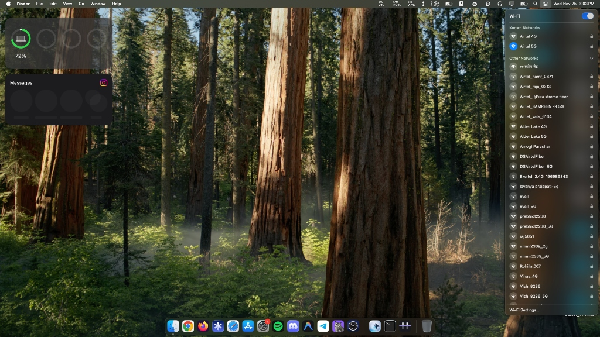
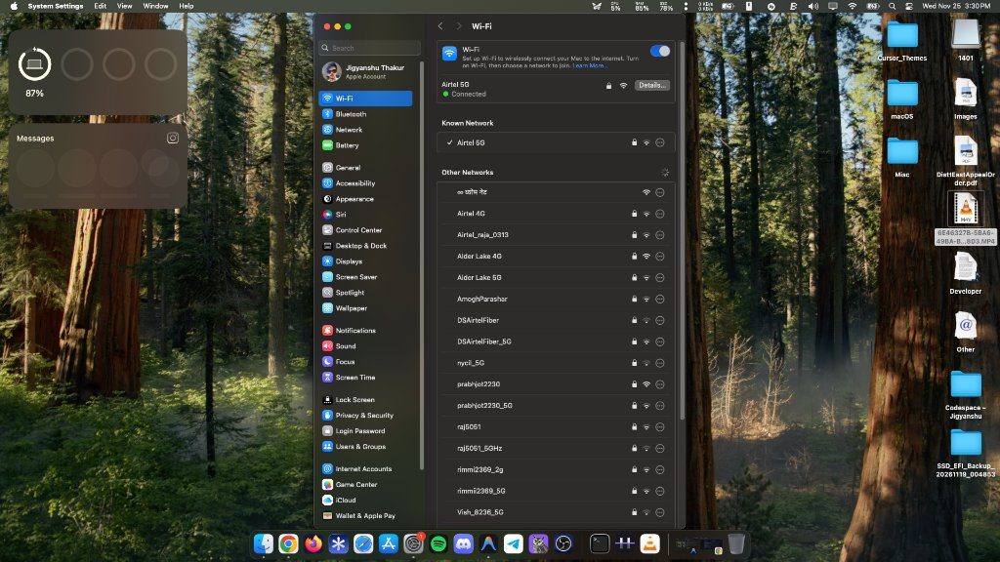

# WTLWireless — Sequoia 15.8.3 (24H241) Port

Native macOS Wi-Fi for **MediaTek MT7902** on **macOS Sequoia 15.8.3** (Build `24H241`), running on an Intel 12th Gen Alder Lake Hackintosh.

This is a fork of [WTLWireless](https://github.com/watchthelight-labs/WTLWireless) by [watchthelight-labs](https://github.com/watchthelight-labs) with ABI support added for Sequoia `24H241` and MT7902-specific core improvements.



## What Is This?

WTLWireless is an open-source (ISC license) macOS kernel extension that provides **native `IO80211Family` integration** for MediaTek MT7902 / MT7925 / MT7927 Wi-Fi cards. Unlike itlwm+HeliPort, this gives you the **real macOS Wi-Fi menu**, System Settings Wi-Fi pane, auto-join, and private MAC addresses — full native integration.

The upstream repo supports macOS Tahoe (26.x) builds. **This fork adds support for macOS Sequoia 15.8.3 (Build `24H241`).**

## Hardware

| Component | Details |
|-----------|---------|
| Laptop | ASUS Vivobook 15 (X1504ZA) |
| CPU | Intel Core i5-1235U (Alder Lake, 2P+8E, 12 threads) |
| GPU | Intel Iris Xe (`8086:46A8`, WhateverXe 0.7.0) |
| Wi-Fi/BT | MediaTek MT7902 (PCI `14C3:7902`) |
| RAM | 20 GB |
| Storage | NVMe SSD (dual boot macOS + Windows 11) |
| Bootloader | OpenCore 0.8.8 |
| SMBIOS | MacBookPro16,2 |

## What Works

- ✅ Native Wi-Fi menu in menu bar
- ✅ System Settings → Wi-Fi with full UI
- ✅ Network scanning (25+ networks, 2.4 GHz + 5 GHz)
- ✅ WPA2-PSK association + 4-way handshake
- ✅ 5 GHz VHT 80 MHz data path
- ✅ Auto-join known networks
- ✅ Private MAC address per network
- ✅ iMessage / FaceTime / Handoff (LQM reporting)
- ✅ Bluetooth (SimpleMtkBtFw + BlueToolFixup)
- ✅ Country code from AP

## What Doesn't Work

- ❌ AirDrop (requires AWDL — [upstream #8](https://github.com/watchthelight-labs/WTLWireless/issues/8))
- ❌ Wireless Sidecar / Continuity Camera (AWDL dependency)
- ❌ 6 GHz / Wi-Fi 6E (MT7902 is 2.4 + 5 GHz only)

## Installation

### Prerequisites

- macOS Sequoia 15.8.3 (Build `24H241`)
- OpenCore bootloader
- MediaTek MT7902 (`14C3:7902`)
- Xcode Command Line Tools

### Quick Install (prebuilt)

1. Download `WTLWireless.kext` from [Releases](../../releases)
2. Copy to your OC `Kexts/` folder
3. Add to `config.plist`:
   - `WTLWireless.kext` — `BundlePath: WTLWireless.kext`
   - `WTLWirelessNative.kext` — `BundlePath: WTLWireless.kext/Contents/PlugIns/WTLWirelessNative.kext`
4. Add boot args: `mtk7902=1 mtkfe=native mtknativeif=1`
5. **Important (ASUS Vivobook / NullMoth `1401` EFI users):** Disable `SSDT-Disable_Network_RP07.aml` (or any SSDT that disables the Wi-Fi PCIe slot) in `config.plist` → `ACPI` → `Add`, otherwise macOS will not see the MT7902 card.
6. Reboot

### Build from Source

```bash
git clone https://github.com/jigyanshu-codes/WTLWireless.git
cd WTLWireless

# Build for Sequoia 24H241
ABI=24H241 ./build.sh

# The kext is at out/WTLWireless.kext
# Copy to your OC EFI:
cp -R out/WTLWireless.kext /Volumes/EFI/EFI/OC/Kexts/
```

### Required Kexts

| Kext | Purpose |
|------|---------|
| **WTLWireless.kext** | MT7902 core driver (firmware, DMA, scan, join, WPA2) |
| **WTLWirelessNative.kext** | Native IO80211 front end (PlugIn inside WTLWireless.kext) |
| **SimpleMtkBtFw.kext** | MediaTek Bluetooth firmware loader |
| **BlueToolFixup.kext** | BT stack compatibility |

### Boot Args

```
mtk7902=1 mtkfe=native mtknativeif=1
```

## What Changed vs Upstream

### New: `abi/24H241/`

Generated ABI headers for macOS Sequoia 15.8.3 (Build `24H241`, xnu `11417.140.69.713.47~2`). These contain the exact struct sizes for:

- `IO80211Controller` (296 bytes)
- `IO80211SkywalkInterface` (280 bytes)
- `IO80211InfraInterface` (288 bytes)
- `IO80211InfraProtocol` (288 bytes)
- `IOSkywalkPacketBufferPool` (184 bytes)
- And 10 more IOSkywalk / IO80211 classes

Sequoia uses slightly smaller structs than Tahoe (e.g., `IO80211SkywalkInterface` is 280 vs 296), so the right sizes are critical — wrong sizes → kernel panic.

### Modified Files

- **`build.sh`** — added `24H241` target
- **`src/native/Info.plist`** — `24H241` ABI entry
- **`src/native/WTLWirelessNativeIf.hpp`** — `24H241` struct size selection
- **`src/native/WTLWirelessNativeIf.cpp`** — `24H241` compatibility
- **`src/native/WTLWirelessNativeReq.cpp`** — `24H241` ioctl adjustments
- **`src/core/MtkChip.cpp`** — MT7902 ConNac2 improvements
- **`src/core/MtkJoin.cpp`** — enhanced association + WPA2 for MT7902
- **`src/core/MtkScan.cpp`** — improved scan + RX for ConNac2
- **`src/core/MtkNet.cpp`** — TX/RX data path improvements
- 11 more files (see commit log)

**Total: +1,592 lines, −437 lines across 20 files.**

## Screenshots

| Wi-Fi Menu | System Settings |
|------------|-----------------|
|  |  |

## Terminal Verification

```
$ kmutil showloaded | grep -i wtl
  org.watchthelight.WTLWireless (0.15.0)
  org.watchthelight.WTLWireless.Native (0.15.0)

$ system_profiler SPAirPortDataType
  en5:
    Card Type: Third-Party Wireless Card
    Firmware Version: WTLWirelessNative 0.15.0
    Supported PHY Modes: 802.11 a/b/g/n/ac
    Country Code: IN

$ ioreg -r -c WTLWirelessNative -l | grep -E "MtkState|IO80211"
  "MtkState" = "W6 pass: en1 passing traffic"
  "IO80211SSID" = "Airtel 5G"
  "IO80211Band" = "5 GHz"
  "IO80211Channel" = 36
  "IO80211ChannelBandwidth" = 80
  "IO80211HardwareVersion" = "MediaTek MT7902"
```

## Credits

- **[watchthelight-labs](https://github.com/watchthelight-labs)** — WTLWireless driver (all the actual driver engineering)
- **[MediaTek](https://www.mediatek.com/)** — mt76 Linux driver (ISC, basis for the core)
- **Hackintosh community** — OpenCore, WhateverXe, Lilu, BlueToolFixup
- **Antigravity (Google DeepMind)** — AI-assisted ABI porting and kernel analysis

## License

ISC License — same as upstream WTLWireless. See [LICENSE](LICENSE) for details.
